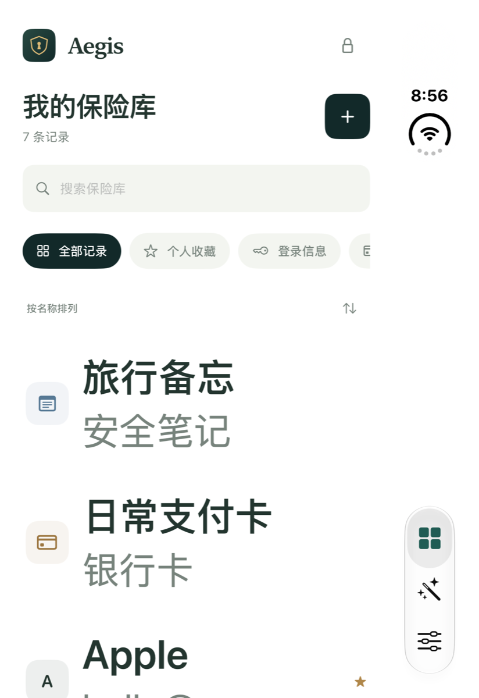

# Aegis UI 深度审查

> 修复状态：下列 8 项审查问题已完成对应修复。原始复现记录保留用于回归；本轮实现与验证见 `Docs/VALIDATION.md` 的“审查问题修复与 Actions”部分。

审查日期：2026-11-05（America/Los_Angeles）。基线为 `36002c5` 加当前工作区的按钮禁用态修复。本轮审查覆盖当前 SwiftUI 主应用、Markdown 编辑器、自动填充界面和用户可见的会话状态，不是密码学或后端安全审计。

**结论：8 项需修复问题，3 项 P1、5 项 P2。应先保证用户内容和关键流程完整，再继续视觉润色。** 上一轮解决的禁用按钮、首次密码条件提示和侧边栏整行命中不重复列为问题。

## 范围与证据

| 范围 | 审查方式 | 结果 |
| --- | --- | --- |
| 首次创建／恢复密钥确认 | 当前代码与内存保险库探针 | 禁用条件已修复；锁定后不能恢复确认流程 |
| 锁定／手动复制 | 完整调用链检查 | iOS 后台锁定会提前清空剪贴板 |
| 编辑／关闭／Markdown 模式切换 | Duo XCUITest 实际操作 | 无确认丢弃草稿、重复格式命令已复现 |
| Mac 导航／详情／设置弹窗 | 原生窗口及辅助功能树 | 设置弹窗中的错误提示不可见 |
| iPhone 导航／设置 | Duo 实际操作 | 设置 Tab 的错误提示可见；大字体适配不完整 |
| 字体／浅色与深色颜色 | 源码、尺寸比较、相对亮度计算 | 固定小字号普遍；浅色辅助文字对比度不足 |
| 触摸目标 | 源码与 Duo 控件 frame | 多个直接图标 Button 未达到统一点击尺寸 |
| 自动填充 | 共用样式及扩展代码检查 | 签名设备与系统启用后的完整填充仍待验证 |
| iCloud 冲突／同步刷新时的编辑器 | 状态流与视图身份检查 | 编辑器依附易变的 revision 身份，存在丢失草稿路径；未进行云端实机复现 |

本次没有安装 iOS 17／macOS 14 专用运行时。Duo 的 Home 操作在探针中未能确认进入 `.runningBackground`，因此没有把后台探针失败当成已复现的应用错误；下面相关结论明确标为锁定调用链确认。iOS 27.1 Duo 的侧边系统导航位置是运行时行为，不作为应用布局缺陷。

## P1：优先修复

### 1. 手动复制的内容会在切到目标 App 时被清空

**平台／证据：iPhone，代码调用链确认。**

路径：`App/AegisApp.swift:50` 在进入后台时调用 `session.lock()`；`App/Services/VaultSession.swift:184` 无条件执行 `SecureClipboard.clear()`；`App/Services/Clipboard.swift:35` 随即清空仍由 Aegis 持有的剪贴板。设置页却写着「30 秒后清理」。

用户在详情复制密码、用户名或恢复密钥后切换到 Safari／另一 App 粘贴，就会触发这条提前清空路径。正常的「复制 → 切换 → 粘贴」操作不能依赖界面承诺的 30 秒窗口。

建议：明确区分手动锁定、后台锁定和剪贴板到期清理；在产品选择的短时窗口内允许手动粘贴，同时保持 local-only 和系统 expirationDate。若决定立即清空，需明确提示并提供可实际使用的替代路径。

验收：复制后切到另一 App 可在设定时限内粘贴，到期后不能继续读取；不清除用户随后复制的其他内容。

### 2. 编辑草稿缺少关闭保护，也缺少独立生命周期

**平台／证据：两端代码；Duo 已复现关闭丢失。**

路径：`App/Views/ItemEditorView.swift:8` 将整个草稿存于视图 `@State`；第 15 行关闭按钮、第 49 行取消直接 dismiss；第 62 行只在 `saving` 期间禁止手势关闭，没有检测未保存修改。

复现：编辑 Apple 的备注，输入临时文本，点击右上角关闭，再次编辑；文本消失，过程中没有放弃修改确认。

同一生命周期问题还影响自动锁定和同步刷新：RootView 切换到锁定视图会销毁表单；`App/Views/VaultView.swift:83`、`:254` 使用 `.id(entry.id)` 绑定 revision 身份，当前记录收到新版本时会重建承载编辑器的详情视图。后两条为代码确认，未做真实 CloudKit 往返复现。

建议：区分显式放弃与系统生命周期事件。关闭有修改的表单时确认；把可恢复草稿放在独立编辑会话中，锁定时安全封存，解锁后恢复；使用稳定 item ID 作为详情身份，并把远端新版本作为冲突信息处理。

验收：关闭／下滑／Escape 有放弃提示；长笔记在后台锁定、尺寸切换和同步刷新后可恢复；草稿不以明文写入磁盘。

### 3. 恢复密钥确认流程在锁定后无法继续

**平台／证据：两端锁定路径代码确认，后台真机复测待做。**

路径：`App/Services/VaultSession.swift:132` 先保存保险库 header，`:134` 把恢复密钥仅放入内存；`:184` 锁定时直接清空 `recoveryKey`。主密码解锁路径不重新提供恢复密钥，也不检查 `recoveryAcknowledged`。`App/AegisApp.swift:61` 完全依赖 `recoveryKey != nil` 展示确认页。

因此在尚未抄写完成时发生锁定、进程退出或休眠，用户下次进入已创建的保险库，却无法继续「我已保存恢复密钥」流程，也没有重新生成恢复密钥的入口。禁用按钮只能阻止点击，不能保证流程完成。

建议：将「待确认」作为可恢复的初始化状态。选择可安全恢复的密钥展示方案，或重新验证主密码后生成并替换恢复密钥。不要为恢复界面而明文持久化恢复密钥。

验收：未确认就中断，重新解锁仍能完成恢复配置；只有明确确认后才进入常规流程；进程重启也覆盖。

## P2：交互与可读性

### 4. 切换预览会再次执行上一个 Markdown 格式命令

**平台／证据：两端共享逻辑；Duo 已复现。**

路径：`App/Views/MarkdownComposer.swift:18` 保留最近一次 command；`:36` 的条件分支销毁／重建原生编辑器。`App/Views/MarkdownSourceEditor.swift:62` 与 `:178` 只对比 Coordinator 内的 `lastCommand`，新 Coordinator 没有旧的消费记录。

实际结果：`Line` → 点击 Todo 得到 `- [ ] Line` → 预览 → 书写 → 自动变为 `- [ ] - [ ] Line`。仅查看预览就修改了内容。原生编辑器重建还会丢失当前实例的撤销栈。

建议：让格式命令具有一次消费语义，执行成功后由稳定的编辑会话确认；切换模式时保留编辑器或显式保留撤销上下文。

验收：对每种格式操作执行任意次数的书写／预览切换，原文不发生额外变化；返回后撤销仍按用户编辑顺序工作。

### 5. Mac 设置弹窗内发生错误时没有可见反馈

**平台／证据：Mac 原生窗口已观察，iPhone 设置 Tab 对照探针显示正常。**

路径：`App/AegisApp.swift:58` 统一在根视图呈现 `session.error`；设置由 `App/Views/VaultView.swift:66` 的 sheet 打开，设置本身没有接收该错误的 alert。`App/Views/UtilityViews.swift:152` 的立即同步通过 `VaultSession.connectCloud()` 写入根层错误。

复现：Mac 示例保险库 → 偏好设置 → 立即同步。因未配置 CloudKit，代码写入配置错误，但当前设置窗口没有可见提示，也没有状态变化；关闭设置后亦未观察到补发提示。对照 iPhone 内嵌设置 Tab，错误 alert 可见。因此不能只靠一个平台的成功结果认为弹窗错误链路完整。

建议：由当前呈现层负责错误反馈，或统一维护明确的 presenter 路由；备份导入、保存失败、生物识别失败也要逐层验证。

验收：每个操作失败时，错误出现在用户正在操作的面板中，不被底层 sheet 遮挡，不要求关闭窗口才能理解结果。

### 6. 大字体适配不完整，界面文字层级反转

**平台／证据：iPhone 运行时与代码确认。**

路径示例：`App/Views/VaultView.swift:168` 主标题与搜索栏采用固定字号；`App/Views/DesignSystem.swift:196`、`:211`、`:236` 的节标题、输入标签和弹窗标题同样固定。只有部分记录行、详情和 Markdown 使用 `@ScaledMetric`。

Duo 对比：系统从普通字号改到 Accessibility XXXL，保险库标题高度始终为 **33.67pt**；记录行文字却显著增大。结果是列表项目比页面标题大很多，而操作提示仍只有 10～13pt，用户放大系统字体并没有改善关键控制区的阅读。

建议：统一语义字体／ScaledMetric；在辅助功能字号下允许按钮与分段选项换行或纵向排列，避免固定高度剪裁。

验收：最小到辅助功能最大档均可读、可操作；标题和辅助文案保持合理层级，输入与保存操作可达。

### 7. 浅色辅助文字的对比度偏低

**平台／证据：两端共用颜色，相对亮度计算。**

`App/Views/DesignSystem.swift:19` 的 secondary `#77837C` 被大量 10～13pt 文案使用：

| 背景 | 对比度 |
| --- | --- |
| surface `#FFFFFF` | 3.95:1 |
| background `#F7F8F5` | 3.70:1 |
| sidebar `#EEF1EB` | 3.46:1 |

均低于普通小字号文字常用的 4.5:1 基准。深色 secondary / surface 约为 6.85:1，问题主要在浅色。此结论针对仍需阅读的标签、账号和说明，不把禁用控件按同一标准判错。

建议：加深浅色辅助文字，减少关键说明使用 10～11pt；颜色 token 要逐个验证前景／背景组合，而不是只看独立色值。

验收：普通正文和辅助文案至少 4.5:1，关键状态不能仅靠颜色区分。

### 8. 小图标按钮尚未统一点击区域

**平台／证据：iPhone 控件 frame 与代码确认。**

共用 `AegisIconButton` 已做到 iOS 44pt，但仍有直接写的 Button 绕过它。`App/Views/ItemEditorView.swift:76` 的显示密码按钮在 Duo 层级中只有约 **20.3 × 12.7pt**；`App/Views/ItemDetailView.swift:88` 的更多操作为 **28 × 36pt**；`App/Views/VaultView.swift:205` 排序菜单为 **32 × 32pt**。输入框外层 padding 不能自动等同于图标按钮的可点击面积。

建议：复用统一的交互尺寸和 contentShape；小图标可保持视觉尺寸，但命中区域扩至至少 44 × 44pt。

验收：点击图标周边空白也能正确触发，且不会抢占相邻输入框、复制按钮或滚动手势。

## 需要后续专项验证的项目

- iOS 隐私遮罩目前加在 RootView 内容层，而编辑器／恢复密钥是 sheet 或 fullScreenCover。需在真机 App Switcher 中验证最上层敏感页面是否被遮住，不能将 `.privacySensitive()` 视为通用截图保护。本次未取得可确认的系统后台快照，故不列为已复现缺陷。
- 真实 CloudKit 新版本到达时，编辑面板的状态保留与冲突呈现。
- Face ID／Touch ID 不可用、取消、权限拒绝、已登记生物识别变化后的实际提示；自动填充系统扩展中的取消与域名确认。
- 大笔记（接近 256 KB）连续输入时，实时预览会为每次变化创建 detached 解析任务；需要专项测量 CPU、内存和输入延迟。
- VoiceOver 完整导航、键盘 Tab 顺序以及最小尺寸窗口的覆盖；当前检查以 AX 标签／尺寸和核心流程为主。

## 修复顺序与交付物

1. 草稿与恢复密钥流程的生命周期；明确手动复制和锁定策略。
2. Markdown 命令只执行一次，恢复可用的撤销与预览行为。
3. 当前弹窗的错误反馈，以及全局异步状态一致性。
4. 字号、浅色对比度和触摸命中范围。

本轮未修改产品源码。临时审查探针与原始结果保存在被忽略的 `.build/artifacts.noindex/ui-audit/`、`.build/artifacts.noindex/results/UIAudit*.xcresult`。探针中确认现状的断言不等于修复验收测试，后台探针的失败来自无法确认模拟器进入后台状态；正式工程已恢复到审查前配置。
