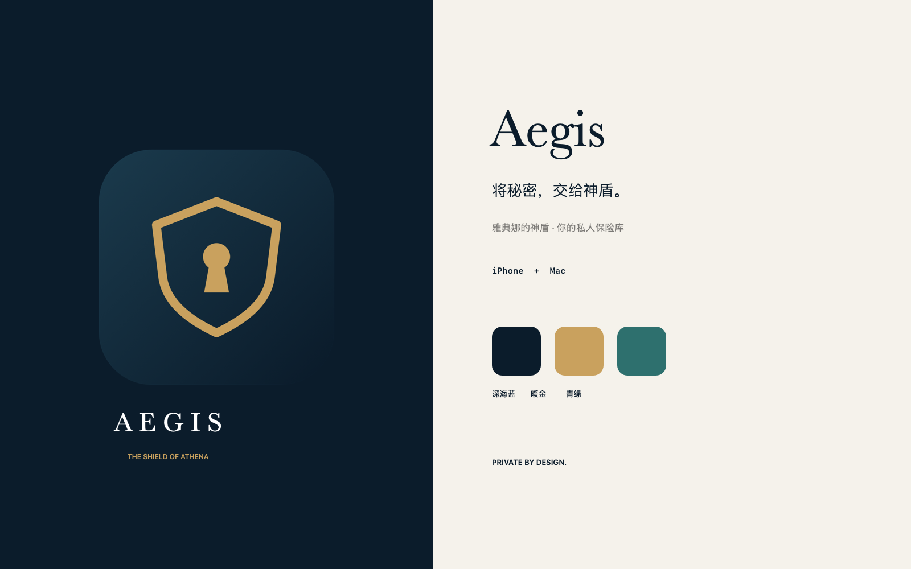

# Aegis · 神盾

SwiftUI 密码管理器，支持 **iOS 17+ / macOS 14+**。名字来自希腊神话中的 Aegis 神盾。视觉采用深海蓝、暖金与青绿，标志将盾牌和钥匙孔结合。



## 打开项目

首次打开 Xcode 前运行 `python3 Scripts/build_isolation.py prepare`，再打开 `Aegis.xcodeproj`，选择 `Aegis-iOS` 或 `Aegis-macOS` Scheme。配置只写入被 Git 忽略的本机 workspace 设置；如果 Xcode 已经打开，重新打开项目以应用隔离路径。

- Swift 6 严格并发、Observation、SwiftData、CKSyncEngine。
- 本地包 `Packages/AegisKit`：加密、存储、同步与 Markdown 渲染。
- 初始配置关闭云连接，避免未签名构建访问未授权 CloudKit 容器。
- 启用 iCloud / 自动填充前，完成 [Apple 服务配置](Docs/APPLE_SETUP.md)。
- 初始界面只有简体中文，所有产品文案见 [本地化说明](Docs/LOCALIZATION.md)。
- 界面采用暖白与墨绿的统一设计，Mac 使用三栏，iOS 根据窗口宽度切换导航；组件规范见 [UI 设计说明](Docs/UI_DESIGN.md)。

项目生成源文件为 `project.yml`，工程文件已生成并纳入交付。修改 Target 或构建配置后运行：

```sh
xcodegen generate
```

## 当前实现

- 主密码创建 / 解锁、恢复密钥解锁、设备生物识别解锁。
- 登录凭据、银行卡、安全笔记、收藏、搜索、密码生成。
- 密码默认 16 位，生成器配置保存在本机；编辑器与独立生成器共用长度及字符类型配置。
- 安全笔记、登录信息备注、银行卡备注均支持 Markdown 编辑、预览和复制原文。
- 备注面板右下角可展开：Mac 支持宽屏编辑／实时对照，iPhone 使用全屏编辑；提供光标处插入格式的快捷工具栏。
- 未保存编辑会加密保留为本机草稿；关闭时可保留或放弃，锁定后解锁可继续。恢复密钥在确认前也以加密状态保留，支持中断后继续确认。
- 加密本地存储、加密导出、验证后导入同一保险库。
- iCloud 私有数据库同步；不可变记录版本保留并发冲突；回收站使用加密删除标记。
- iOS / macOS Credential Provider 扩展：读取共享密文快照，输入主密码后选择凭据并确认填充。
- 应用锁定时清除可见条目和密钥引用；5 分钟无交互后锁定；复制内容 30 秒后清理。
- iOS 进入后台锁定，但保留本机剪贴板的 30 秒粘贴窗口；手动锁定立即清理。Mac 在系统睡眠、显示器休眠或切换系统用户时锁定，切换普通窗口不会立即锁定。

这是可构建的首版实现。CloudKit 实机往返、生物识别与系统自动填充的签名设备验证仍需完成，详见配置文档。主密码修改 / 密钥轮换、共享保险库、Passkey、Chrome 扩展不在当前实现中。

## 验证

```sh
bash Scripts/test.sh                         # 脚本边界测试 + 本地化检查 + Swift 核心测试
bash Scripts/build.sh macos Debug             # Mac 主应用与自动填充扩展
bash Scripts/build.sh ios-simulator Debug     # iOS 模拟器构建
bash Scripts/build.sh ios Release             # iOS 设备无签名构建，仅用于编译验证
bash Scripts/preview.sh                       # 构建、临时签名、打开 Mac 示例保险库
bash Scripts/test.sh --ui <simulator-UDID>    # 另加 iOS 实际界面测试
```

iOS 的 `AegisUITests` 提供记录编辑、Markdown 预览保存和工具导航的实际界面测试。选择可用模拟器后，可通过 Xcode 的 Test 操作运行；测试仅使用独立内存示例保险库。

Debug 构建可带 `--preview-vault` 启动，使用独立内存保险库和合成示例数据，不连接 iCloud，不写入正式数据库。预览数据随进程退出消失；不要在预览窗口保存真实凭据。预览解锁短语为 `Aegis preview fixture only`。

首次进入流程的 UI 测试使用 `--preview-onboarding`，从空的内存保险库开始，验证创建条件、恢复密钥确认和禁用态反馈；此模式同样不会访问现有保险库或 iCloud。

## 打包与发布

```sh
bash Scripts/package.sh                      # dist/ 下生成 macOS 通用版 DMG 与无签名 iOS IPA，各附 SHA-256
bash Scripts/package.sh dmg --build-number 7 # 只打 DMG，并指定构建号
```

无需 Apple 开发者账号：Mac App 为 ad-hoc 签名并保留 App Sandbox，未经公证；IPA 未签名，需自行重新签名。iCloud 同步与系统自动填充依赖描述文件授予的受限权限，这两类包中均不可用。打包时用命令行设置覆盖 `Config/Local.xcconfig`，开发者团队、Bundle 前缀、App Group 与 iCloud 容器不会进入安装包。DMG 需要 `uv`，用于按固定版本运行 `dmgbuild`。

发布版本：

1. 修改 `project.yml` 的 `MARKETING_VERSION`，运行 `xcodegen generate` 并提交。
2. 推送 tag `v<MARKETING_VERSION>`，例如 `git tag -a v0.2.0 -m "Aegis 0.2.0" && git push origin v0.2.0`。
3. `.github/workflows/package.yml` 核对 tag 与 `project.yml` 一致并运行完整测试，然后并行构建 DMG 与 IPA、生成 GitHub 构建来源证明，最后确认 tag 未移动、校验 SHA-256 并创建 Release。tag 与版本号不一致时不会构建。

下载的安装包可用 `gh attestation verify <文件> --repo tianguzhe/Aegis` 核实来源。

## 构建隔离与开发副本

构建、测试、预览和日志集中到 `.build/artifacts.noindex/`，避免应用搜索中积累同名开发副本。两个共享 Scheme 在构建、测试、运行、性能分析和归档结束后按路径注销开发应用的 LaunchServices 注册；清理不删除文件、不结束运行中的应用、不重置系统索引。

```sh
python3 Scripts/build_isolation.py status
python3 Scripts/build_isolation.py cleanup --dry-run
python3 Scripts/build_isolation.py cleanup
```

`AEGIS_BUILD_DIR` 可指定 `.build/artifacts.noindex/` 内的 DerivedData 子目录。首次解析依赖需要访问 GitHub；后续构建复用缓存。仅注销 LaunchServices 无法阻止 Spotlight 重新索引旧 `build/` 中的应用；退出从该目录运行的开发应用后，可执行 `python3 Scripts/build_isolation.py archive-legacy`，将旧目录完整迁入 `.build/artifacts.noindex/legacy-build-*/build/`。迁移保留全部应用和日志，不覆盖已有归档；运行中的旧应用会阻止迁移。`/Applications`、`~/Applications` 中的安装副本和其他工程的 DerivedData 不会被处理。

流程参考 [ProcScope 最新提交 2e46736](https://github.com/tianguzhe/ProcScope/commit/2e4673654533756748e30a985d6e9e7cd0291f73)，增加了 Aegis 的 iOS、嵌入扩展和 Swift Package 验证。完整路径、CI 和边界说明见 [构建隔离](Docs/BUILD_ISOLATION.md)。push / PR 的 GitHub Actions 会运行核心测试和两端构建，完整诊断日志保留 7 天。

## 品牌文件

- `Brand/aegis-mark.svg`：可编辑矢量标志。
- `Brand/Aegis-Icon.png`：1024px Mac 图标。
- `Brand/Aegis-Brand.png`：品牌预览板。
- `App/Assets.xcassets/AppIcon.appiconset`：iOS / macOS 全套图标。
- `Scripts/render_brand.swift`：本地 AppKit 图标生成脚本。

## 加密与依赖

Argon2id v1.3，默认 64 MiB / 3 次迭代 / 并行度 1。官方 C 实现固定于 `20190702` 发布版并包含许可证。CryptoKit AES-256-GCM 加密随机保险库密钥与每条记录；nonce 每次重新生成，AAD 绑定保险库、记录、版本与父版本 ID。

有关密钥、数据格式和安全边界，见 [架构说明](Docs/ARCHITECTURE.md)。
